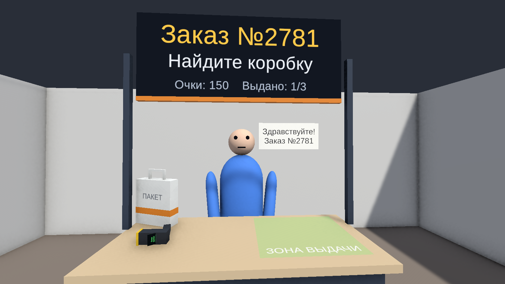
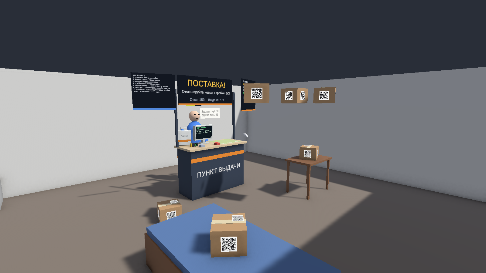

# ПВЗ MR — «Пункт выдачи заказов» в смешанной реальности

Учебный проект (ИТМО, практика VR/MR). Игрок работает сотрудником пункта выдачи заказов прямо в своей комнате:
через passthrough гарнитуры видна реальная комната, в ней стоит виртуальная стойка ПВЗ, к стойке подходят
виртуальные клиенты, а игрок ищет по комнате коробки с QR-кодами, сканирует их и выдаёт заказ.

- **Движок:** Unity 6000.2.2f1, URP, OpenXR, XR Interaction Toolkit 3.2, AR Foundation 6.5 + Unity OpenXR: Meta 2.5
- **Целевое устройство:** Meta Quest 3 / 3S (Android)
- **Сканирование QR в прототипе — имитация:** QR на коробке — это текстура, сканер узнаёт коробку лучом.

## Что умеет прототип (MVP)
0. **Выбор сложности** кнопками на стойке: «Лёгкая» (без поставки и пакетов, клиенты ждут сколько угодно,
   пошаговые подсказки на первом заказе), «Обычная» (терпение 90 с), «Сложная» (45 с). На «Обычной» и «Сложной»
   клиенты торопят на 60 % терпения и уходят без заказа (−50 очков); над головой — полоска терпения.
   Кнопка «Стойку ко мне» переносит игровую зону перед игроком.
1. Клиент подходит к стойке и называет номер заказа (реплика + табло).
2. Игрок берёт ручной сканер со стойки, наводит на коробку и жмёт курок — на экране сканера номер заказа
   коробки и «НУЖНАЯ КОРОБКА» / «НЕ ТОТ ЗАКАЗ».
3. Нужную коробку кладут в зелёную **зону выдачи** на стойке. Правильная — клиент благодарит, забирает её и уходит,
   начисляются очки. Неправильная — «Это не мой заказ!», штраф.
4. **Поставка:** после первого клиента с потолка падают новые коробки — их нужно принять на склад сканером
   (до этого клиенты их не заказывают) и разложить по комнате.
5. **Заказ из нескольких коробок** («Коробок в заказе: 2») — клиент ждёт, пока выданы все.
   **Пакет:** иногда клиент после выдачи просит «Мне ещё нужен пакет» — пакеты лежат на стойке, пакет кладут в зону выдачи.
6. **Очередь:** до трёх клиентов ждут в линию (зависит от сложности), у каждого свой заказ.
7. Когда склад пуст и поставка принята и выдана — экран «Смена завершена» со статистикой и рейтингом,
   кнопка «Новая смена». Лучший результат по каждой сложности сохраняется («Новый рекорд!»).

## Как запустить в редакторе (без шлема)
1. Открыть проект в Unity 6000.2.2f1, сцену `Assets/_Project/Scenes/Game.unity`, нажать Play.
2. Управление — **XR Interaction Simulator** (подсказки по клавишам выводятся на экран в Play Mode):
   перемещение WASD, обзор мышью с зажатой ПКМ, захват контроллером — G, курок (сканирование) — T/ЛКМ
   в зависимости от режима симулятора.
3. В редакторе включена «мок-комната» (пол, стены, стол, кровать) — на шлеме вместо неё реальная комната.

## Готовый APK
Последняя сборка лежит в [GitHub Releases](https://github.com/paradisemay/pvz-mr/releases): `adb install pvz-mr.apk` (режим разработчика на Quest). На шлеме не проверялась.

## Как собрать на Quest
`File → Build Profiles → Android → Build`. Настройки OpenXR/Player уже применены (`PVZ → Apply Project Setup`).
На устройстве не проверялось — шлема у разработчика не было.

## Для разработчиков
- Пересобрать сцену и ассеты: меню **PVZ → Build Scene And Assets** или
  `./tools/run-unity.ps1 -Method Pvz.Editor.PvzSceneBuilder.BuildAll`
- Тесты: `./tools/run-unity.ps1 -Method Pvz.Editor.PvzTestRunner.RunEditMode -NoQuit -Extra '-pvzResults','Logs/editmode.xml'`
  (и `RunPlayMode` для сквозных тестов)
- Скриншоты для PR: **PVZ → Capture Screenshots** (с целью сборки Standalone:
  `./tools/run-unity.ps1 -Method Pvz.Editor.PvzScreenshots.CaptureAll -Extra '-buildTarget','Win64'`)
- APK для Quest: **PVZ → Build Quest APK** или `./tools/run-unity.ps1 -Method Pvz.Editor.PvzBuild.BuildQuestApk -NoQuit -Extra '-buildTarget','Android'`

## Документация
- [docs/REPORT.md](docs/REPORT.md) — **итоговый отчёт**: что сделано, как проверено, ограничения, бэклог
- [docs/IMPLEMENTATION_PLAN.md](docs/IMPLEMENTATION_PLAN.md) — исходный план (исторический; реализация от него отличается, актуально — docs/context/)
- [docs/context/](docs/context/) — контекст проекта (Context-Driven Development): продукт, стек, архитектура, процесс, треки

## Ветки
`feature/*` → PR в `dev` → PR в `main`. В `main` попадает только то, что прошло ревью и тесты.
