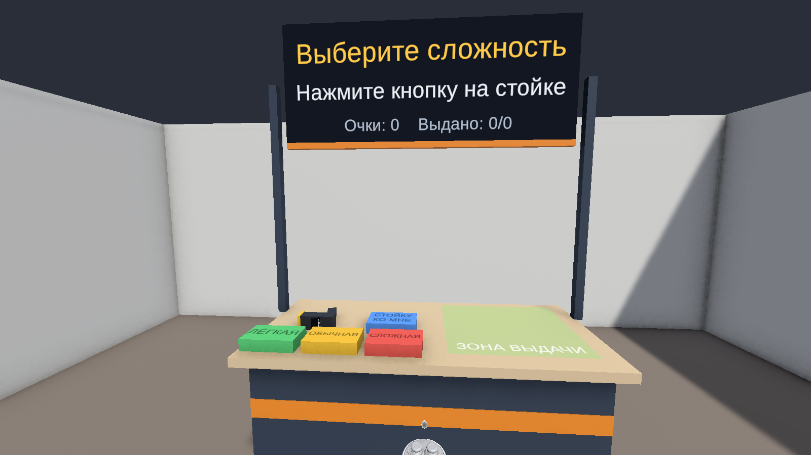
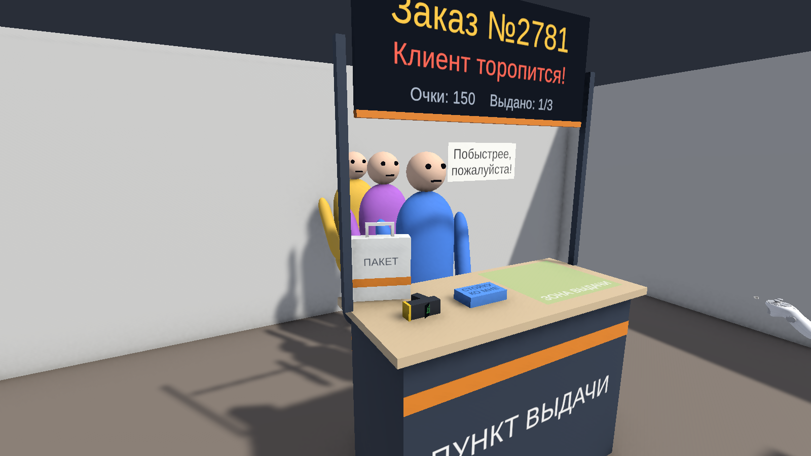
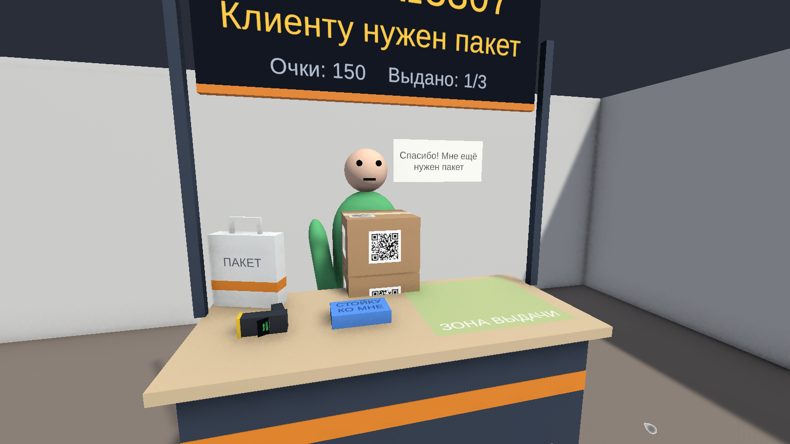

# Отчёт о реализации прототипа «ПВЗ MR»

Дата: 13.11.2026 · Репозиторий: <https://github.com/paradisemay/pvz-mr> · Релиз с APK: см. GitHub Releases

## 1. Что получилось

Играбельный MR-прототип «Пункт выдачи заказов» на Unity 6 для Meta Quest 3/3S. Собирается в APK; в редакторе
проходится целиком через XR Interaction Simulator; логика и сквозные сценарии покрыты автотестами.


| Механика из концепции | Статус | Трек |
|---|---|---|
| Passthrough: игра в реальной комнате, плоскости (с разрешением `USE_SCENE`) | настроено, APK собирается; **на шлеме не проверено** | T001, T003, T008 |
| Виртуальная стойка ПВЗ, табло, зона выдачи, «Стойку ко мне» | готово | T003, T008 |
| Клиент: подходит, называет заказ, реагирует, уходит | готово | T003 |
| Коробки с QR, ручной сканер (QR — имитация, по заданию) | готово | T003 |
| Проверка правильной коробки, штраф за неверную | готово | T002, T003 |
| Итоги смены, очки, рейтинг, «Новая смена» | готово | T002, T003 |
| «Поставка»: коробки падают с потолка, приёмка сканером | готово | T004 |
| Заказ из нескольких коробок («Коробок в заказе: N») | готово | T005 |
| Доп. запрос «Мне ещё нужен пакет» | готово | T005 |
| Уровни сложности (Лёгкая / Обычная / Сложная) | готово | T006 |
| Клиенты торопят и уходят без заказа | готово | T006 |
| Очередь клиентов (до 3), разные заказы у каждого | готово | T007 |
| Возвраты, пересканирование, голосовые реплики, настоящие модели | бэклог | — |
| Реальные физические коробки и распознавание QR камерой | вне скоупа прототипа | — |

| | |
|---|---|
|  |  |
|  |  |

## 2. Как устроено

- **Core** (`Assets/_Project/Scripts/Core`, без `UnityEngine`): склад, заказы, стойка, смена, очередь, поставка,
  пакет, терпение, очки, рейтинг — чистые правила, проверяются EditMode-тестами.
- **Runtime:** тонкие компоненты сцены. `ShiftDirector` — композиция, темп и проброс ввода,
  `ShiftPresenter` — все тексты и звуки по событиям Core.
- **Editor:** сцена, префабы, QR-текстуры, шрифт с кириллицей и пресеты сложности генерируются кодом
  (`PVZ → Build Scene And Assets`); скриншоты, раннер тестов, сборка APK.
- Подробнее и принятые решения: [context/architecture.md](context/architecture.md).

## 3. Как работали

- **Context-Driven Development:** `docs/context/` — продукт, стек, архитектура, процесс; у каждого трека `spec.md` + `plan.md`.
- **Ветки:** `feature/* → dev → main`; 8 треков (T000–T008), каждый — отдельный PR в `dev`; релизы в `main`.
- **Ревью:** каждый PR с кодом проверяли два «чистых» агента без контекста автора — код-ревью и архитектурное.
  Найденное исправлялось до мержа, в том числе:
  - XR-симулятор попадал в сборку и «замораживал» бы трекинг на шлеме;
  - коробка поставки могла упасть за стену → смену нельзя закончить;
  - пакет, положенный в зону заранее, не засчитывался → смена вставала;
  - клиент, ушедший после частичной выдачи, уносил коробки;
  - события Core поднимались до фиксации состояния;
  - правила смены, расписание поставки и очередь «утекали» в MonoBehaviour → перенесены в Core.
- **Тесты:** EditMode 112, PlayMode 15 — Core, целостность сцены и сквозные сценарии в настоящей сцене
  (полная смена с поставкой, пакетами и ошибочной выдачей, очередь, нетерпеливый клиент, меню сложности,
  «Стойку ко мне», raycast сканера, падение коробок поставки, раздатчик пакетов).
- **Сбой процесса и вывод:** один коммит (правки T006 по ревью) не дошёл до GitHub из-за сетевой ошибки,
  которую скрыл подавленный вывод `git push`; обнаружено при сборке T008, донесено отдельным PR #12.
  С тех пор push проверяется сравнением с `git ls-remote`.

## 4. Как запустить и проверить

```bash
# сцена и ассеты
./tools/run-unity.ps1 -Method Pvz.Editor.PvzSceneBuilder.BuildAll
# тесты
./tools/run-unity.ps1 -Method Pvz.Editor.PvzTestRunner.RunEditMode -NoQuit -Extra '-pvzResults','Logs/editmode.xml'
./tools/run-unity.ps1 -Method Pvz.Editor.PvzTestRunner.RunPlayMode -NoQuit -Extra '-pvzResults','Logs/playmode.xml'
# APK для Quest
./tools/run-unity.ps1 -Method Pvz.Editor.PvzBuild.BuildQuestApk -NoQuit -Extra '-buildTarget','Android'
```
В редакторе: открыть `Assets/_Project/Scenes/Game.unity`, нажать Play, выбрать сложность кнопкой на стойке
(управление — XR Interaction Simulator).

## 5. Ограничения и риски

- **Шлема не было.** Passthrough, плоскости, запрос `USE_SCENE`, выравнивание игровой зоны и управление
  контроллерами на Quest не проверялись. Первое, что нужно сделать на устройстве, — пройти смену целиком.
- В редакторе с активной целью Android Unlit-материалы (табло, зона выдачи, экран сканера) рендерятся заглушкой;
  с целью Standalone — корректно. Скриншоты снимаются с `-buildTarget Win64`. На шлеме проверить эти материалы первыми.
- Клиенты идут по прямой и не знают о реальной мебели.
- Сцена генерируется кодом. Когда появятся настоящие модели, билдер нужно перевести в режим
  «проверить и связать», чтобы он не затирал работу художника.

## 6. Что дальше (бэклог)

1. Прогон на Quest 3 и исправление найденного.
2. Явный список заказов в Core со статусами — перед терпением в очереди и несколькими стойками.
3. Обобщённые доп. запросы (`ExtraRequest`): возврат, пересканирование, подсчёт товаров.
4. Модели и анимации клиентов, звук и голос — задачи для 3D-художника.
5. Сохранение лучшего результата и расположения склада между сессиями.
