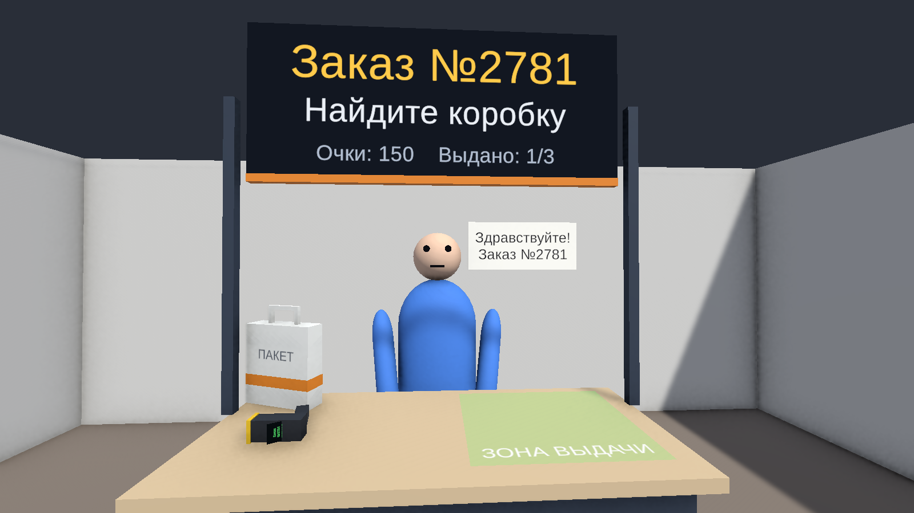
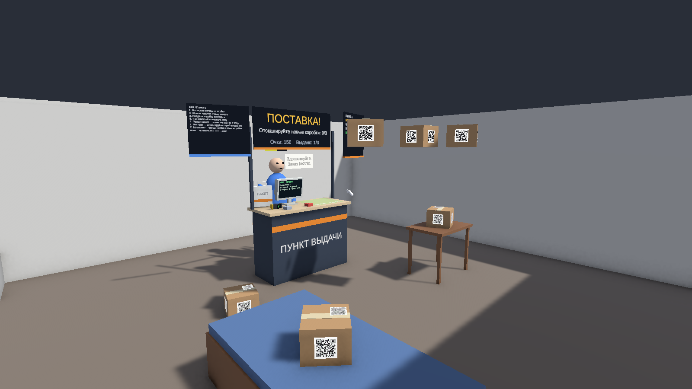
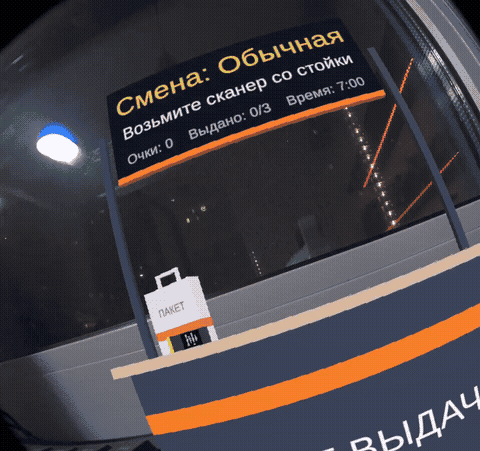
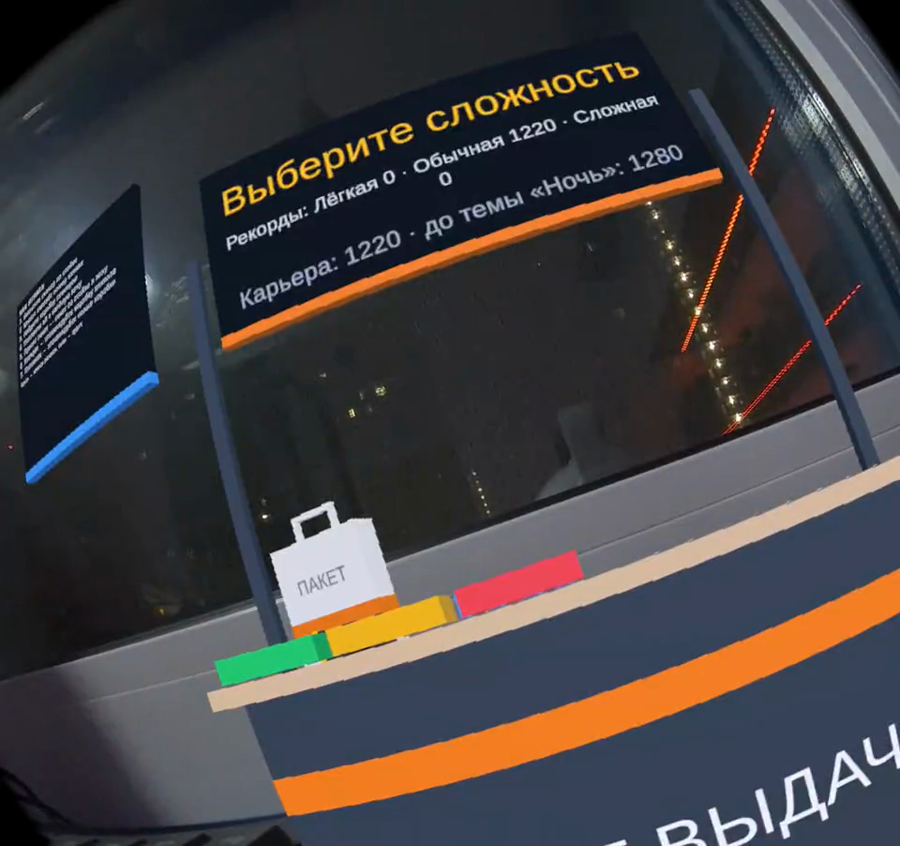
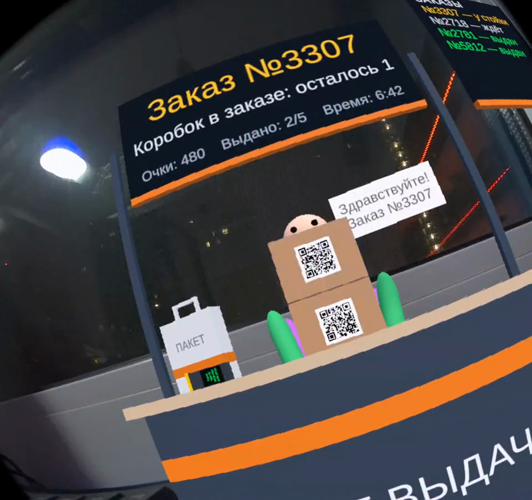
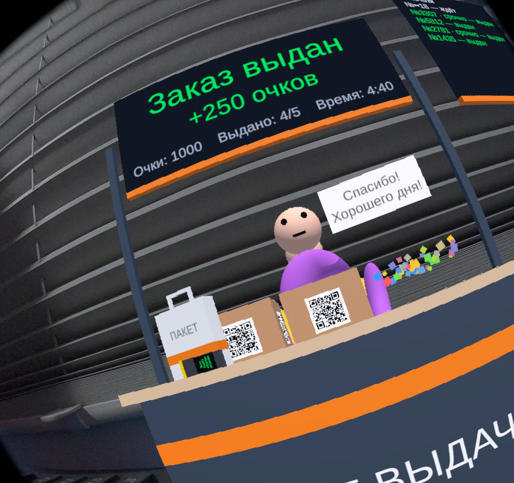
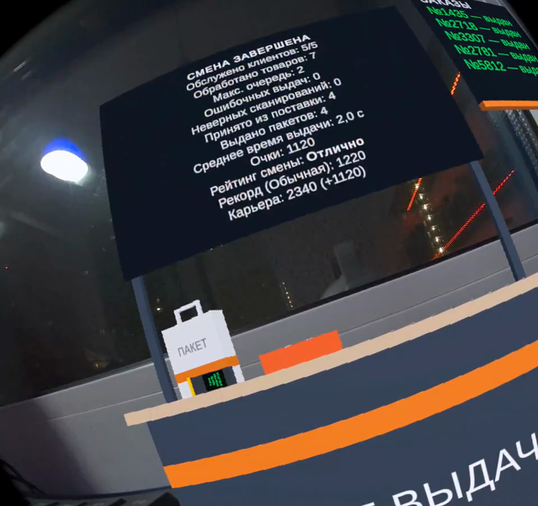

# Отчёт о реализации прототипа «ПВЗ MR»

Дата: 14.11.2026 · Репозиторий: <https://github.com/paradisemay/pvz-mr> · Последний релиз с APK: [v1.20.0](https://github.com/paradisemay/pvz-mr/releases/tag/v1.20.0)

## 1. Что получилось

Играбельный MR-прототип «Пункт выдачи заказов» на Unity 6 для Meta Quest 3/3S. Собирается в APK и **проверен на Quest 3**
(смена целиком в смешанной реальности, 90 Гц); в редакторе проходится через XR Interaction Simulator; логика и
сквозные сценарии покрыты автотестами.



| Механика из концепции | Статус | Трек |
|---|---|---|
| Passthrough: игра в реальной комнате, плоскости (с разрешением `USE_SCENE`) | проверено на Quest 3: стойка и клиенты в настоящей комнате (плоскости отдельно не проверялись) | T001, T003, T008, T026 |
| Виртуальная стойка ПВЗ, табло, зона выдачи, «Стойку ко мне» | готово | T003, T008 |
| Клиент: подходит, называет заказ, реагирует, уходит | готово | T003 |
| Коробки с QR, ручной сканер (QR — имитация, по заданию) | готово | T003 |
| Проверка правильной коробки, штраф за неверную | готово | T002, T003 |
| Итоги смены, очки, рейтинг, «Новая смена» | готово | T002, T003 |
| «Поставка»: коробки падают с потолка, приёмка сканером | готово | T004 |
| Заказ из нескольких коробок («Коробок в заказе: N») | готово | T005 |
| Доп. запрос «Мне ещё нужен пакет» | готово | T005 |
| Уровни сложности (Лёгкая / Обычная / Сложная) | готово | T006 |
| Клиенты торопят и уходят без заказа | готово | T006 |
| Очередь клиентов (до 3), разные заказы у каждого | готово | T007 |
| Рекорды по сложностям (меню, «Новый рекорд!») | готово | T009 |
| Полоска терпения над клиентом | готово | T010 |
| Пошаговые подсказки на первом заказе (Лёгкая) | готово | T011 |
| Полная статистика смены (товары, макс. очередь) | готово | T012 |
| Возвраты: клиент приносит проданную коробку, скан на стойке | готово | T013 |
| Случайные события: срочный заказ, клиент забыл номер | готово | T014 |
| Таймер смены: обратный отсчёт, очередь расходится, итоги «время вышло» | готово | T015 |
| Похожие заказы: сканер и клиент предупреждают о похожем номере | готово | T016 |
| Сохранение расположения склада между сессиями (относительно стойки) | готово | T017 |
| Кнопка «Сбросить склад» в стартовом меню | готово | T020 |
| Голос клиентов (процедурная заглушка), вспышка экрана сканера, конфетти при выдаче | готово | T018 |
| Список заказов со статусами на стойке (ждёт / у стойки / выдан / ушёл) | готово | T019 |
| Карьера между сменами и открываемые темы стойки («Мята», «Ночь», «Золото») | готово | T022 |
| Большой заказ: три коробки одного заказа в поставке | готово | T023 |
| Памятка «Как играть» в стартовом меню (для первого прогона без автора) | готово | T024 |
| Пульт отладки: управление игрой на шлеме с компьютера по adb, автопилот, запись видео | готово | T026 |
| Коробки в руках клиента не закрывают лицо (найдено на шлеме) | готово | T027 |
| 90 Гц на Quest 3 вместо 72 | готово | T028 |
| Настоящие модели и записанные голоса, привязка склада к комнате (якоря) | бэклог | — |
| Реальные физические коробки и распознавание QR камерой | вне скоупа прототипа | — |

| | |
|---|---|
|  |  |
|  |  |
|  |  |
|  |  |
|  |  |

## На Quest 3

Смена на «Обычной» сложности прошла на шлеме автопилотом через пульт (T026): 5/5 клиентов, 3 возврата, срочные и
похожие заказы, без ошибок. Производительность: 72/72 FPS (GPU 23 %), после T028 — 90/90 FPS под нагрузкой (GPU ≈ 29 %, 36 °C).



| Меню | Большой заказ (до T027) | После T027 | Итог смены |
|---|---|---|---|
|  |  |  |  |

Видео: [mr-shift-normal.mp4](media/device/mr-shift-normal.mp4). Кадры — с экрана шлема (левый глаз).

## 2. Как устроено

- **Core** (`Assets/_Project/Scripts/Core`, без `UnityEngine`): склад, заказы, стойка, смена, книга заказов (очередь —
  её вид), поставка, пакет, терпение, часы смены, возвраты, события, похожие номера, раскладка склада, карьера, очки,
  рейтинг — чистые правила, проверяются EditMode-тестами.
- **Runtime:** тонкие компоненты сцены. `ShiftDirector` — композиция, темп и проброс ввода смены;
  `ShiftPresenter` решает, что показать и озвучить, компоненты сцены исполняют (табло, сканер, голос, конфетти).
  То, что живёт между сменами, — отдельные компоненты: `WarehouseLayoutKeeper` (раскладка склада), `CareerKeeper` (карьера и темы).
- **Editor:** сцена, префабы, QR-текстуры, шрифт с кириллицей и пресеты сложности генерируются кодом
  (`PVZ → Build Scene And Assets`); скриншоты, раннер тестов, сборка APK.
- Подробнее и принятые решения: [context/architecture.md](context/architecture.md).

## 3. Как работали

- **Context-Driven Development:** `docs/context/` — продукт, стек, архитектура, процесс; у каждого трека `spec.md` + `plan.md`.
- **Ветки:** `feature/* → dev → main`; 29 треков (T000–T028), каждый — отдельный PR в `dev`; релизы в `main`.
- **Ревью:** PR с кодом проверяли «чистые» агенты без контекста автора. Для T001–T019 и T022 — два ревью (код и
  архитектура); для небольших T020, T021, T025 (рефакторинги без изменения поведения) и T024, T026–T028 — одно совмещённое (для T026 — код, безопасность сокета, архитектура);
  T023 (только данные поставки) агентом не ревьюился — его проверяют тесты данных и сквозная смена. В каждом PR это указано.
  Найденное исправлялось до мержа, в том числе:
  - XR-симулятор попадал в сборку и «замораживал» бы трекинг на шлеме;
  - коробка поставки могла упасть за стену → смену нельзя закончить;
  - пакет, положенный в зону заранее, не засчитывался → смена вставала;
  - клиент, ушедший после частичной выдачи, уносил коробки;
  - события Core поднимались до фиксации состояния;
  - правила смены, расписание поставки и очередь «утекали» в MonoBehaviour → перенесены в Core.
- **Тесты:** EditMode 264, PlayMode 32 — Core, целостность сцены и сквозные сценарии в настоящей сцене
  (полная смена с поставкой, пакетами и ошибочной выдачей, очередь, нетерпеливый клиент, меню сложности,
  «Стойку ко мне», raycast сканера, падение коробок поставки, раздатчик пакетов, возврат, забывчивый клиент, конец смены по времени,
  раскладка склада и её сброс, голос/вспышка/конфетти, список заказов, темы стойки, автопилот пульта и его сокет с токеном).
- **Проверка чистым клоном:** `main` (v1.16.0) клонирован с GitHub в пустую папку, проект импортирован с нуля —
  EditMode 245/245 и PlayMode 28/28. Значит, в репозитории есть всё необходимое (метафайлы, сцена, ассеты, настройки).
- **Сбой процесса и вывод:** один коммит (правки T006 по ревью) не дошёл до GitHub из-за сетевой ошибки,
  которую скрыл подавленный вывод `git push`; обнаружено при сборке T008, донесено отдельным PR #12.
  С тех пор push проверяется сравнением с `git ls-remote`.
- **Ещё один вывод:** APK v1.8.0 собирался, пока в рабочую папку уже писался следующий трек, и Unity подхватил новые
  файлы. APK пересобран из чистого дерева и заменён в релизе; во время сборок в `Assets/` больше ничего не пишется.
- **Найдено попутно:** экран сканера с T001 наполовину уходил в корпус — нижние строки сообщений не было видно
  (замечено на скриншоте T016 и там же исправлено; прогон скриншотов теперь предупреждает о не влезающем тексте).

## 4. Как запустить и проверить

```bash
# сцена и ассеты
./tools/run-unity.ps1 -Method Pvz.Editor.PvzSceneBuilder.BuildAll
# тесты
./tools/run-unity.ps1 -Method Pvz.Editor.PvzTestRunner.RunEditMode -NoQuit -Extra '-pvzResults','Logs/editmode.xml'
./tools/run-unity.ps1 -Method Pvz.Editor.PvzTestRunner.RunPlayMode -NoQuit -Extra '-pvzResults','Logs/playmode.xml'
# APK для Quest
./tools/run-unity.ps1 -Method Pvz.Editor.PvzBuild.BuildQuestApk -NoQuit -Extra '-buildTarget','Android'
```
В редакторе: открыть `Assets/_Project/Scenes/Game.unity`, нажать Play, выбрать сложность кнопкой на стойке
(управление — XR Interaction Simulator).

## 5. Ограничения и риски

- **На шлеме проверено** (T026–T028): запуск, passthrough, стойка, клиенты, табло и экран сканера (Unlit-материалы
  на устройстве в порядке), смена целиком, производительность. **Не проверено:** ввод настоящими контроллерами —
  на шлеме смену играл пульт на уровне игры (сканер, выдача), а не виртуальный контроллер XRI; плоскости и запрос
  `USE_SCENE`; громкость голоса. Это первое, что нужно сделать человеку в шлеме.
- Без контроллеров Quest не запускает игру («Переключитесь на контроллеры»); отладочная сборка объявляет руки,
  обычная — нет (игроку нужны контроллеры).- Клиенты идут по прямой и не знают о реальной мебели.
- Сцена генерируется кодом. Когда появятся настоящие модели, билдер нужно перевести в режим
  «проверить и связать», чтобы он не затирал работу художника.

## 6. Что дальше (бэклог)

1. Прогон человеком в шлеме с контроллерами по чек-листу [QUEST_TEST_PLAN.md](QUEST_TEST_PLAN.md) — остальное уже проверено пультом.
2. Громкость голоса, вид конфетти, читаемость маленьких кнопок меню («Сбросить склад», «Тема») — проверить на шлеме первыми.
3. Единый `ActiveVisit` на стойке — когда появится третий вид визита или вторая стойка (книга заказов уже есть — T019/T021).
4. Модели и анимации клиентов, записанные голоса вместо процедурной «речи» — задачи для 3D-художника и звукорежиссёра.
5. Привязать сохранённую раскладку склада к настоящей комнате (якоря Meta; «сбросить склад» уже есть — T020) —
   сейчас (T017) она повторяется относительно стойки, которая выравнивается по игроку в каждой сессии.
